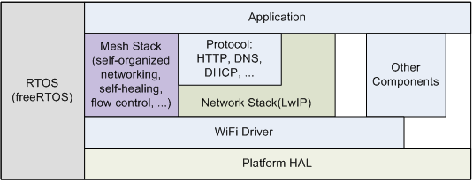
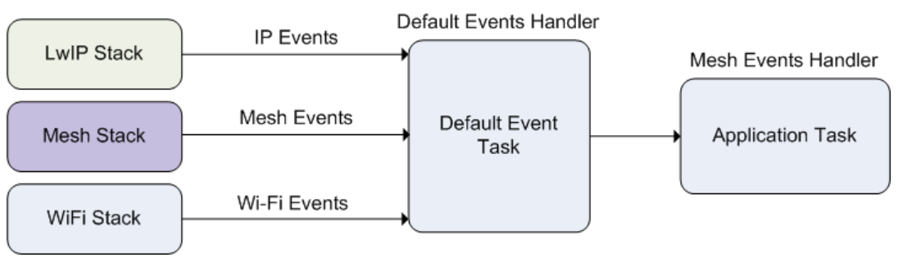

# LAB4. ESP Wi-Fi mesh

## Objetivos

- Revisar los conceptos básicos para la construcción de una red Wi-Fi mesh
  autogestionada.
- Presentar la API básica para la creación de aplicaciones basadas en la pila
  ESP-WIFI-MESH.
- Observar en funcionamiento una red ESP-WIFI-MESH, así como sus capacidades de
  autoconfiguración.

## ESP Wi-Fi mesh

La pila ESP-WIFI-MESH se construye sobre el driver Wi-Fi (es decir, hace uso de sus
servicios). En algunos casos, también hace uso de los servicios de la pila TCP/IP
(*lwIP*), como ocurre en el nodo mesh raíz, que es el único que se comunica mediante
IP con un router de borde. El siguiente diagrama muestra la situación de la pila mesh
en ESP-IDF:



Como otros componentes de ESP-IDF, ESP-WIFI-MESH se comunica con las aplicaciones a
través de eventos específicos:



El tipo `mesh_event_id_t` define los eventos que pueden producirse durante las distintas
fases del ciclo de vida de una red mesh (por ejemplo, para un nodo determinado, la
conexión o desconexión de su nodo padre o de uno de sus nodos hijo). Antes de utilizar
los eventos de ESP-WIFI-MESH para gestionar u observar el funcionamiento de la red mesh,
es necesario registrar los manejadores vía `esp_event_handler_register()`.

Algunos usos típicos de estos eventos incluyen, por ejemplo, detectar la conexión con un
nodo padre (`MESH_EVENT_PARENT_CONNECTED`) o de un nodo hijo (`MESH_EVENT_CHILD_CONNECTED`).
Estos eventos indican, respectivamente, que el nodo puede comenzar a transmitir datos hacia
el nodo padre o que un nuevo nodo hijo se ha conectado. Del mismo modo, en el nodo raíz, los
eventos `IP_EVENT_STA_GOT_IP` e `IP_EVENT_STA_LOST_IP` permiten detectar si el nodo tiene
dirección IP y, por tanto, si puede comunicarse con la red IP externa.

### Eventos ESP-WIFI-MESH

* `MESH_EVENT_STARTED`: mesh iniciada.

* `MESH_EVENT_STOPPED`: mesh finalizada.

* `MESH_EVENT_CHANNEL_SWITCH`: cambio de canal Wi-Fi.

* `MESH_EVENT_CHILD_CONNECTED`: un hijo se ha conectado a la interfaz `softAP`.

* `MESH_EVENT_CHILD_DISCONNECTED`: un hijo se ha desconectado de la interfaz `softAP`.

* `MESH_EVENT_ROUTING_TABLE_ADD`: se han añadido entradas a la tabla de encaminamiento debido a la incorporación de nuevos hijos.

* `MESH_EVENT_ROUTING_TABLE_REMOVE`: se han eliminado entradas de la tabla de encaminamiento debido a la salida de nodos hijo.

* `MESH_EVENT_PARENT_CONNECTED`: el nodo se ha conectado a un padre a través de la interfaz `sta`.

* `MESH_EVENT_PARENT_DISCONNECTED`: el nodo se ha desconectado de su padre (interfaz `sta`).

* `MESH_EVENT_NO_PARENT_FOUND`: no se ha encontrado un padre.

* `MESH_EVENT_LAYER_CHANGE`: el nodo ha cambiado de nivel en la red mesh.

* `MESH_EVENT_TODS_STATE`: indica que el nodo raíz es capaz de acceder a la red IP externa.

* `MESH_EVENT_VOTE_STARTED`: ha comenzado el proceso de elección de un nuevo nodo raíz.

* `MESH_EVENT_VOTE_STOPPED`: se ha detenido/ha finalizado el proceso de elección de un nuevo nodo raíz.

* `MESH_EVENT_ROOT_ADDRESS`: se ha obtenido la dirección MAC del nodo raíz.

* `MESH_EVENT_ROOT_SWITCH_REQ`: un nodo votado como nuevo nodo raíz solicita sustituir al nodo raíz actual.

* `MESH_EVENT_ROOT_SWITCH_ACK`: el nodo raíz actual responde a la solicitud de cambio.

* `MESH_EVENT_NETWORK_STATE`: se ha producido un cambio en el estado de la red mesh (por ejemplo, se ha encontrado un nodo raíz).

* `MESH_EVENT_STOP_RECONNECTION`: se han detenido los intentos de reconexión del nodo raíz al router de borde y de los demás nodos a sus respectivos padres.

* `MESH_EVENT_FIND_NETWORK`: se ha encontrado una red mesh a la que el nodo puede unirse. Si el canal configurado es 0, la pila explorará todos los canales disponibles, devolviendo el canal de la red encontrada.

### Uso de la pila TCP/IP (lwIP)

Una aplicación que haga uso de ESP-WIFI-MESH puede transmitir datos a través de
la propia pila ESP-WIFI-MESH sin recurrir a la pila TCP/IP. De hecho, la pila
TCP/IP solo es estrictamente necesaria en el nodo raíz, ya que es el único nodo
de la red mesh que se comunica con la red IP externa.

Sin embargo, dado que cualquier nodo de la topología puede convertirse potencialmente
en el nodo raíz (ya que su elección es automática), todos los nodos deberán inicializar
lwIP llamando a `esp_netif_init()`. Para prevenir el acceso de los nodos que no son
raíz a la red IP externa, la aplicación no debe crear interfaces de red adicionales usando
la API de `esp_netif` (más allá de las creadas con `esp_netif_create_default_wifi_mesh_netifs`).

ESP-WIFI-MESH requiere que el nodo raíz esté conectado a un router de borde. Por lo tanto,
en el caso de que un nodo se convierta en raíz, su manejador de eventos correspondiente
debe iniciar el cliente DHCP para obtener inmediatamente una dirección IP. Esto
permitirá a los demás nodos conectarse y comenzar a transmitir/recibir paquetes
hacia/desde la red IP externa. Sin embargo, este paso no será necesario si se utilizan
direcciones IP estáticas.

### Estructura básica de una aplicación ESP-WIFI-MESH

Los requisitos previos para iniciar ESP-WIFI-MESH son inicializar las pilas lwIP y Wi-Fi.
El siguiente fragmento de código muestra los pasos necesarios que deben completarse antes
de inicializar ESP-WIFI-MESH:

```c
ESP_ERROR_CHECK(esp_netif_init());

/* event initialization */
ESP_ERROR_CHECK(esp_event_loop_create_default());

/* wifi initialization */
wifi_init_config_t config = WIFI_INIT_CONFIG_DEFAULT();
ESP_ERROR_CHECK(esp_wifi_init(&config));

/* register IP event handler */
ESP_ERROR_CHECK(esp_event_handler_register(IP_EVENT, IP_EVENT_STA_GOT_IP, &ip_event_handler, NULL));
ESP_ERROR_CHECK(esp_wifi_set_storage(WIFI_STORAGE_FLASH));
ESP_ERROR_CHECK(esp_wifi_start());
```

Tras inicializar lwIP y Wi-Fi, el proceso para poner en marcha una red ESP-WIFI-MESH
puede resumirse en los siguientes tres pasos:

1. Inicializar la pila ESP-WIFI-MESH.
2. Configurar los parámetros de la red mesh.
3. Iniciar la red mesh.

#### Paso 1. Inicializar ESP-WIFI-MESH

La inicialización de la pila ESP-WIFI-MESH y el registro del manejador de eventos mesh
se realizan de la siguiente forma:

```c
/* mesh initialization */
ESP_ERROR_CHECK(esp_mesh_init());

/* register mesh event handler */
ESP_ERROR_CHECK(esp_event_handler_register(MESH_EVENT, ESP_EVENT_ANY_ID, &mesh_event_handler, NULL));
```

#### Paso 2. Configurar la red mesh

ESP-WIFI-MESH se configura mediante la función `esp_mesh_set_config()`, que recibe como
argumento una estructura de tipo `mesh_cfg_t`. Esta estructura contiene los siguientes
parámetros de configuración:

| Parámetro          | Descripción                                                                   |
| ------------------ | ----------------------------------------------------------------------------- |
| *Channel*          | Canal Wi-Fi (entre 1 y 14)                                                    |
| *Mesh ID*          | Identificador de la red mesh (6 bytes)                                        |
| *Router*           | SSID y contraseña del router de borde                                         |
| *Mesh AP*          | Configuración específica del AP generado por cada nodo mesh                   |
| *Crypto functions* | Funciones criptográficas para Mesh IE (intercambio de información de control) |

Un ejemplo de configuración podría ser:

```c
/* default mesh configuration */
mesh_cfg_t cfg = MESH_INIT_CONFIG_DEFAULT();

/* mesh ID */
memcpy((uint8_t *) &cfg.mesh_id, MESH_ID, 6);

/* channel (must match the router's channel) */
cfg.channel = CONFIG_MESH_CHANNEL;

/* router */
cfg.router.ssid_len = strlen(CONFIG_MESH_ROUTER_SSID);
memcpy((uint8_t *) &cfg.router.ssid, CONFIG_MESH_ROUTER_SSID, cfg.router.ssid_len);
memcpy((uint8_t *) &cfg.router.password, CONFIG_MESH_ROUTER_PASSWD, strlen(CONFIG_MESH_ROUTER_PASSWD));

/* mesh softAP */
cfg.mesh_ap.max_connection = CONFIG_MESH_AP_CONNECTIONS;
memcpy((uint8_t *) &cfg.mesh_ap.password, CONFIG_MESH_AP_PASSWD, strlen(CONFIG_MESH_AP_PASSWD));
ESP_ERROR_CHECK(esp_mesh_set_config(&cfg));
```

#### Paso 3. Iniciar la red mesh

El arranque de la red mesh es sencillo:

```c
/* mesh start */
ESP_ERROR_CHECK(esp_mesh_start());
```

Tras iniciar la red, el nodo debe comprobar los eventos recibidos para determinar si
la conexión ha sido exitosa. Una vez conectado, este podrá comenzar a transmitir y
recibir paquetes a través de ESP-WIFI-MESH utilizando las funciones `esp_mesh_send()`
y `esp_mesh_recv()`.

## Despliegue conjunto de una red Wi-Fi mesh

La forma más adecuada de observar el comportamiento de una red Wi-Fi mesh es desplegar
una infraestructura con un número suficiente de nodos que pertenezcan a una misma red.

En esta práctica vamos a desplegar una red Wi-Fi mesh en el laboratorio utilizando
vuestros ESP32 como nodos. Para ello, configuraremos, compilaremos y ejecutaremos
el ejemplo ***internal_communication***, ubicado en la carpeta *mesh*. Antes de
proceder, configuraremos el proyecto para:

1. Conectarse al AP común del laboratorio (SSID de 2.4 GHz).
2. Configurar el AP de cada nodo mesh para que utilice autenticación WPA2-PSK
y la contraseña ***password***.
3. Aumentar a 10 el número máximo de conexiones (hijos) del AP de cada nodo mesh.

De momento no realizaremos ningún cambio en el código del ejemplo. Una vez configurado
el proyecto, compílalo, ejecútalo y monitoriza la salida estándar del nodo para obtener
la siguiente información:

1. Direcciones MAC de las interfaces `sta` y `softAP` de tu nodo mesh.
2. Capa de la topología mesh en la que se encuentra tu nodo.
3. En caso de haber sido elegido nodo raíz, anota también la IP asignada por el router
de borde.

Apunta toda esta información en la siguiente [hoja de Google](https://docs.google.com/spreadsheets/d/1TA2H8bN15cz3IVLtNOqxHP73AZ1flaX7sLl5Hms8xaY/edit?usp=sharing).
Antes de rellenar los campos correspondientes a la capa y la dirección MAC del padre,
espera a que el profesor te indique que la topología ha convergido y que, por tanto,
no se producirán más cambios en esta (siempre que ningún nodo deje la red).

!!! danger "Ejercicio 1"
    Captura el estado de la red cuando todos/as tus compañeros/as hayan llegado al
    estado de convergencia. Documenta el proceso y las salidas de tus nodos mesh, y
    representa la topología final mediante un grafo.

A continuación, apagaremos el nodo raíz y esperaremos a que la red elija un nuevo nodo
raíz y vuelva a converger.

!!! danger "Ejercicio 2"
    Captura de nuevo el estado de la red cuando todos/as tus compañeros/as hayan
    llegado al estado de convergencia. Documenta el proceso y las salidas de tus nodos
    mesh, y representa la nueva topología final mediante un grafo.

## Despliegue de redes Wi-Fi mesh de menores dimensiones

Finalmente, vamos a crear nuevas redes mesh en función del puesto en el que estés
sentado/a. Consulta los colores asignados a cada puesto del laboratorio en la hoja
de Google y modifica el ejemplo para que el identificador de la red (*Mesh ID*)
coincida con el indicado.

!!! danger "Ejercicio 3"
    Captura el estado de la red cuando los demás nodos de tu red mesh hayan llegado al
    estado de convergencia. Documenta el proceso y las salidas de tus nodos mesh, y
    representa la topología final mediante un grafo.

!!! danger "Ejercicio 4"
    Analiza el código del ejemplo e intenta comprender su funcionamiento, en particular,
    cómo se envían y reciben los datos y quiénes son sus destinatarios. ¿Qué hace realmente
    esta aplicación Wi-Fi mesh?
