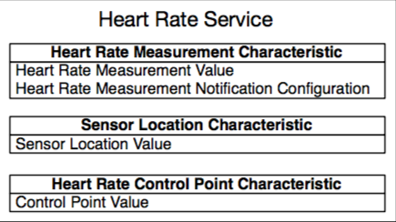

# LAB5. BLE: servidor GATT

## Objetivos

* Diseccionar en detalle un *firmware* de construcción de tabla GATT (servidor
GATT) utilizando la API de ESP-IDF.
* Aprender a utilizar la herramienta `gatttool` para interactuar con el servidor GATT.
* Modificar el servidor GATT para que acepte solicitudes de suscripción a notificaciones
por parte del cliente y permita enviar valores actualizados de una característica determinada.

# Implementación de un servidor GATT

## Introducción

En esta práctica, desplegaremos un servidor GATT utilizando la API de ESP-IDF. Dicha API expone
las funcionalidades de Bluedroid, la pila de protocolos Bluetooth (incluido BLE) que proporciona
ESP-IDF para el desarrollo de aplicaciones Bluetooth.

El ejemplo que vamos a trabajar es ***gatt_server_service_table***, dentro de la carpeta
*bluetooth/bluedroid/ble*. Dada la complejidad del ejemplo (al menos inicialmente), esta práctica
comienza con un recorrido por la preparación y construcción del servidor siguiendo una estructura
de tabla que define los servicios y características que implementará el servidor GATT.

El ejemplo implementa el servicio *Heart Rate Service* definido en la
[especificación Bluetooth](https://www.bluetooth.com/specifications/profiles-overview),
cuya estructura es la siguiente:

<div align="center"> </div>

Desplegaremos, por tanto, tres características. La más relevante para esta práctica será la
correspondiente a la medición de ritmo cardíaco, que incluye el valor de medición
(*Heart Rate Measurement Value*) y su descriptor de configuración de notificaciones
(*Heart Rate Measurement Notification Configuration*).

## Inclusión de cabeceras

Los siguientes ficheros de cabecera son necesarios para dotar de funcionalidad BLE a nuestro *firmware*:

```c
#include "freertos/FreeRTOS.h"
#include "freertos/task.h"
#include "freertos/event_groups.h"
#include "esp_system.h"
#include "esp_log.h"
#include "nvs_flash.h"
#include "esp_bt.h"

#include "esp_gap_ble_api.h"
#include "esp_gatts_api.h"
#include "esp_bt_main.h"
#include "esp_bt_device.h"
#include "gatts_table_creat_demo.h"
#include "esp_gatt_common_api.h"
```

Estas cabeceras son necesarias para el correcto funcionamiento de FreeRTOS y de sus componentes,
incluyendo funcionalidades relativas a *logging* y al almacenamiento no volátil. Resultan especialmente
interesantes las cabeceras `esp_bt.h`, `esp_bt_main.h`, `esp_gap_ble_api.h` y `esp_gatts_api.h`,
ya que exponen la API BLE necesaria para la implementación del *firmware*:

* `esp_bt.h`: proporciona las funciones relacionadas con el controlador Bluetooth.
* `esp_bt_main.h`: declara las funciones de inicialización y activación de la pila Bluedroid.
* `esp_gap_ble_api.h`: proporciona la API GAP (para la configuración de los parámetros de anuncio y conexión).
* `esp_gatts_api.h`: proporciona la API del servidor GATT (para la gestión de servicios y características).

## La tabla de servicios

El fichero de cabecera `gatts_table_creat_demo.h`, incluido en el directorio *main* del ejemplo, contiene
una enumeración de los atributos del servicio *Heart Rate*:

```c
enum
{
    IDX_SVC,
    IDX_CHAR_A,
    IDX_CHAR_VAL_A,
    IDX_CHAR_CFG_A,

    IDX_CHAR_B,
    IDX_CHAR_VAL_B,

    IDX_CHAR_C,
    IDX_CHAR_VAL_C,

    HRS_IDX_NB,
};
```

Los elementos de la enumeración anterior se han incluido en el mismo orden que los atributos del servicio,
comenzando con el propio servicio y continuando con sus características. Además, la característica *Heart
Rate Measurement* cuenta con un descriptor de configuración (*Client Characteristic Configuration Descriptor*,
o CCCD), que permite al cliente habilitar/deshabilitar las notificaciones de dicha característica. Todos estos
índices pueden utilizarse para identificar cada elemento a la hora de crear la tabla de atributos:

* `IDX_SVC`: índice del servicio *Heart Rate*.
* `IDX_CHAR_A`: índice de la declaración de la característica *Heart Rate Measurement*.
* `IDX_CHAR_VAL_A`: índice del valor de la característica *Heart Rate Measurement*.
* `IDX_CHAR_CFG_A`: índice del descriptor CCCD de la característica *Heart Rate Measurement*
* `IDX_CHAR_B`: índice de la declaración de la característica *Sensor Location*.
* `IDX_CHAR_VAL_B`: índice del valor de la característica *Sensor Location*.
* `IDX_CHAR_C`: índice de la declaración de la característica *Heart Rate Control Point*.
* `IDX_CHAR_VAL_C`: índice del valor de la característica *Heart Rate Control Point*.
* `IDX_NB`: número total de elementos de la tabla.

## Inicio de la aplicación

El punto de entrada de la aplicación (`app_main()`) se implementa de la siguiente manera:

```c
void app_main(void)
{
    esp_err_t ret;

    /* Initialize NVS. */
    ret = nvs_flash_init();
    if (ret == ESP_ERR_NVS_NO_FREE_PAGES || ret == ESP_ERR_NVS_NEW_VERSION_FOUND) {
        ESP_ERROR_CHECK(nvs_flash_erase());
        ret = nvs_flash_init();
    }
    ESP_ERROR_CHECK(ret);

    ESP_ERROR_CHECK(esp_bt_controller_mem_release(ESP_BT_MODE_CLASSIC_BT));

    esp_bt_controller_config_t bt_cfg = BT_CONTROLLER_INIT_CONFIG_DEFAULT();
    ret = esp_bt_controller_init(&bt_cfg);
    if (ret) {
        ESP_LOGE(GATTS_TABLE_TAG, "%s enable controller failed: %s", __func__, esp_err_to_name(ret));
        return;
    }

    ret = esp_bt_controller_enable(ESP_BT_MODE_BLE);
    if (ret) {
        ESP_LOGE(GATTS_TABLE_TAG, "%s enable controller failed: %s", __func__, esp_err_to_name(ret));
        return;
    }

    esp_bluedroid_config_t cfg = BT_BLUEDROID_INIT_CONFIG_DEFAULT();
    ret = esp_bluedroid_init_with_cfg(&cfg);
    if (ret) {
        ESP_LOGE(GATTS_TABLE_TAG, "%s init bluetooth failed: %s", __func__, esp_err_to_name(ret));
        return;
    }

    ret = esp_bluedroid_enable();
    if (ret) {
        ESP_LOGE(GATTS_TABLE_TAG, "%s enable bluetooth failed: %s", __func__, esp_err_to_name(ret));
        return;
    }

    ret = esp_ble_gatts_register_callback(gatts_event_handler);
    if (ret){
        ESP_LOGE(GATTS_TABLE_TAG, "gatts register error, error code = %x", ret);
        return;
    }

    ret = esp_ble_gap_register_callback(gap_event_handler);
    if (ret){
        ESP_LOGE(GATTS_TABLE_TAG, "gap register error, error code = %x", ret);
        return;
    }

    ret = esp_ble_gatts_app_register(ESP_APP_ID);
    if (ret){
        ESP_LOGE(GATTS_TABLE_TAG, "gatts app register error, error code = %x", ret);
        return;
    }

    esp_err_t local_mtu_ret = esp_ble_gatt_set_local_mtu(500);
    if (local_mtu_ret){
        ESP_LOGE(GATTS_TABLE_TAG, "set local  MTU failed, error code = %x", local_mtu_ret);
    }
}
```

### Inicialización de la flash para almacenamiento no volátil

La función `app_main()` comienza inicializando el almacenamiento no volátil, que permite persistir los
parámetros necesarios en la memoria *flash*:

```c
ret = nvs_flash_init();
```

### Inicialización y configuración de BLE

A continuación, la función principal inicializa el controlador Bluetooth, creando en primer lugar una
estructura de configuración de tipo `esp_bt_controller_config_t` con los valores por defecto definidos
por la macro `BT_CONTROLLER_INIT_CONFIG_DEFAULT()`.

El controlador Bluetooth implementa la interfaz *Host Controller Interface* (HCI), la capa de enlace y
la capa física (todo ello transparente para el programador). La configuración incluye el tamaño de pila
reservado al controlador, la prioridad y la velocidad de transmisión. Con estos parámetros, el
controlador puede inicializarse mediante la función `esp_bt_controller_init()`:

```c
esp_bt_controller_config_t bt_cfg = BT_CONTROLLER_INIT_CONFIG_DEFAULT();
ret = esp_bt_controller_init(&bt_cfg);
```

Una vez inicializado el controlador, se activa el modo BLE:

```c
ret = esp_bt_controller_enable(ESP_BT_MODE_BLE);
```

Existen cuatro modos de funcionamiento del controlador Bluetooth:

* `ESP_BT_MODE_IDLE`: Bluetooth no funcional.
* `ESP_BT_MODE_BLE`: modo BLE.
* `ESP_BT_MODE_CLASSIC_BT`: modo Bluetooth clásico.
* `ESP_BT_MODE_BTDM`: modo dual (BLE + Bluetooth clásico).

Tras la inicialización y activación del controlador Bluetooth, se inicializa y activa la pila Bluedroid
(capas superiores), que incluye APIs tanto para BLE como para Bluetooth clásico:

```c
ret = esp_bluedroid_init();
ret = esp_bluedroid_enable();
```

La pila Bluetooth está, a partir de este punto, lista para funcionar, pero todavía no se ha implementado
ninguna lógica de aplicación. Dicha funcionalidad se define mediante el clásico mecanismo basado en
eventos, que pueden emitirse, por ejemplo, cuando otro dispositivo intenta leer o escribir atributos o
establecer una conexión.

La aplicación necesita registrar dos funciones de *callback* para gestionar los eventos de BLE, una para
GATT y otra para GAP:

```c
ret = esp_ble_gatts_register_callback(gatts_event_handler);
ret = esp_ble_gap_register_callback(gap_event_handler);
```

En la aplicación de ejemplo, estos *callbacks* son las funciones `gatts_event_handler()` y
`gap_event_handler()`, encargadas de manejar los eventos enviados por la pila BLE a la aplicación.

### Perfiles de aplicación

El objetivo es implementar un perfil de aplicación para el servicio *Heart Rate*. Un perfil de
aplicación es un mecanismo que permite agrupar funcionalidades diseñadas para ser utilizadas por un
cliente de la aplicación, por ejemplo, una aplicación móvil. Un mismo servidor GATT puede implementar
uno o más perfiles de aplicación (diferentes aplicaciones BLE).

El identificador de perfil de aplicación (*Application Profile ID*) es un valor interno configurable
que permite identificar cada perfil y cuyo uso se limita al registro del perfil en la pila Bluetooth
del servidor GATT. En el ejemplo, este ID es `0x55`:

```c
#define PROFILE_NUM                  1
#define PROFILE_APP_IDX              0
#define ESP_APP_ID                   0x55
```

Los perfiles se almacenan en el array `heart_rate_profile_tab`, de tipo `gatts_profile_inst`. Al haber un único
perfil en el ejemplo, solo se almacena un elemento en el array con índice 0 (tal y como se define en
`PROFILE_APP_IDX`). Cabe destacar que también es necesario inicializar una función de *callback* encargada de
manejar los eventos del perfil de aplicación.

A su vez, cada aplicación registrada utiliza una interfaz lógica diferente (un número), representada por el
parámetro `gatts_if`. Durante la inicialización, este parámetro se establece a `ESP_GATT_IF_NONE`. Cuando más
adelante se registre la aplicación, la pila Bluetooth asignará a `gatts_if` el identificador de la interfaz
correspondiente.

```c
/* One gatt-based profile one app_id and one gatts_if, this array will store the gatts_if returned by ESP_GATTS_REG_EVT */
static struct gatts_profile_inst heart_rate_profile_tab[PROFILE_NUM] = {
    [PROFILE_APP_IDX] = {
        .gatts_cb = gatts_profile_event_handler,
        .gatts_if = ESP_GATT_IF_NONE, /* Not get the gatt_if, so initial is ESP_GATT_IF_NONE */
    },
};
```

La estructura `gatts_profile_inst` presenta los siguientes campos (no todos se utilizan en el ejemplo):

```c
struct gatts_profile_inst
{
    esp_gatts_cb_t gatts_cb;
    uint16_t gatts_if;
    uint16_t app_id;
    uint16_t conn_id;
    uint16_t service_handle;
    esp_gatt_srvc_id_t service_id;
    uint16_t char_handle;
    esp_bt_uuid_t char_uuid;
    esp_gatt_perm_t perm;
    esp_gatt_char_prop_t property;
    uint16_t descr_handle;
    esp_bt_uuid_t descr_uuid;
};
```

El registro del perfil de aplicación tiene lugar al final de la función `app_main()`, utilizando la función `esp_ble_gatts_app_register()`:

```c
ret = esp_ble_gatts_app_register(ESP_APP_ID);
```

## Evento de registro de la aplicación

El evento `ESP_GATTS_REG_EVT` se genera como consecuencia del registro del perfil de aplicación. Este evento
es tratado por el *callback* registrado como manejador de eventos de GATT:

```c
static void gatts_event_handler(esp_gatts_cb_event_t event, esp_gatt_if_t gatts_if, esp_ble_gatts_cb_param_t *param)
{
    /* If event is register event, store the gatts_if for each profile */
    if (event == ESP_GATTS_REG_EVT) {
        if (param->reg.status == ESP_GATT_OK) {
            heart_rate_profile_tab[PROFILE_APP_IDX].gatts_if = gatts_if;
        } else {
            ESP_LOGE(GATTS_TABLE_TAG, "reg app failed, app_id %04x, status %d", param->reg.app_id, param->reg.status);
            return;
        }
    }
    do {
        int idx;
        for (idx = 0; idx < PROFILE_NUM; idx++) {
            /* ESP_GATT_IF_NONE, not specify a certain gatt_if, need to call every profile cb function */
            if (gatts_if == ESP_GATT_IF_NONE || gatts_if == heart_rate_profile_tab[idx].gatts_if) {
                if (heart_rate_profile_tab[idx].gatts_cb) {
                    heart_rate_profile_tab[idx].gatts_cb(event, gatts_if, param);
                }
            }
        }
    } while (0);
}
```

Los parámetros asociados al evento `ESP_GATTS_REG_EVT` son:

```c
esp_gatt_status_t status;    /* Estado de la operación */
esp_gatt_if_t gatts_if;      /* Interfaz GATTS asignada por la pila BLE */
uint16_t app_id;             /* ID de aplicación (0x55) */
```

A partir de este momento se deberá usar la interfaz `gatts_if` para operar, por lo que la función registra
esta interfaz en el array de descripción de perfiles de aplicación (`heart_rate_profile_tab`).

Finalmente, la función delega el evento en el *callback* registrado para tratar los eventos asociados a la
aplicación (`gatts_profile_event_handler()`).

## Parámetros GAP

Como ya hemos visto, el manejo del evento `ESP_GATTS_REG_EVT` es delegado a la función `gatts_profile_event_handler()`
por el manejador de eventos de GATT:

```c
static void gatts_profile_event_handler(esp_gatts_cb_event_t event, esp_gatt_if_t gatts_if, esp_ble_gatts_cb_param_t *param)
{
    switch (event) {
        case ESP_GATTS_REG_EVT:{
            esp_err_t set_dev_name_ret = esp_ble_gap_set_device_name(SAMPLE_DEVICE_NAME);
            if (set_dev_name_ret){
                ESP_LOGE(GATTS_TABLE_TAG, "set device name failed, error code = %x", set_dev_name_ret);
            }
    #ifdef CONFIG_SET_RAW_ADV_DATA
            esp_err_t raw_adv_ret = esp_ble_gap_config_adv_data_raw(raw_adv_data, sizeof(raw_adv_data));
            if (raw_adv_ret){
                ESP_LOGE(GATTS_TABLE_TAG, "config raw adv data failed, error code = %x ", raw_adv_ret);
            }
            adv_config_done |= ADV_CONFIG_FLAG;
            esp_err_t raw_scan_ret = esp_ble_gap_config_scan_rsp_data_raw(raw_scan_rsp_data, sizeof(raw_scan_rsp_data));
            if (raw_scan_ret){
                ESP_LOGE(GATTS_TABLE_TAG, "config raw scan rsp data failed, error code = %x", raw_scan_ret);
            }
            adv_config_done |= SCAN_RSP_CONFIG_FLAG;
    #else
            ...
    #endif
            esp_err_t create_attr_ret = esp_ble_gatts_create_attr_tab(gatt_db, gatts_if, HRS_IDX_NB, SVC_INST_ID);
            if (create_attr_ret){
                ESP_LOGE(GATTS_TABLE_TAG, "create attr table failed, error code = %x", create_attr_ret);
            }
        }
       	    break;
        ...
}
```

Esta función utiliza el evento para configurar parámetros GAP (de anuncio). Las funciones asociadas son:

* `esp_ble_gap_set_device_name()`: utilizada para establecer el nombre del dispositivo anunciado.
* `esp_ble_gap_config_adv_data_raw()`: usada para configurar los datos estándar de anuncio.

Como podemos ver en el código anterior, se comienza estableciendo el nombre del dispositivo. A continuación,
se configuran los datos de anuncio. La función `esp_ble_gap_config_adv_data_raw()` toma un puntero a un array
de bytes con los datos. Cada dato anunciado se compone de:

* Campo *longitud*: indica el número de bytes que ocupa el dato, sin contar el propio campo longitud (es
decir, cuántos bytes vienen después).
* Campo *tipo*: indica el tipo de dato según el documento [Bluetooth Assigned Numbers
Document](https://www.bluetooth.com/wp-content/uploads/Files/Specification/HTML/Assigned_Numbers/out/en/Assigned_Numbers.pdf).
* Campo *datos*: contiene los bytes del dato anunciado.

Podemos ver que en nuestro ejemplo el anuncio envía:

```c
static uint8_t raw_adv_data[] = {
    /* Flags */
    0x02, ESP_BLE_AD_TYPE_FLAG, 0x06,
    /* TX Power Level */
    0x02, ESP_BLE_AD_TYPE_TX_PWR, 0xEB,
    /* Complete 16-bit Service UUIDs */
    0x03, ESP_BLE_AD_TYPE_16SRV_CMPL, 0xFF, 0x00,
    /* Complete Local Name */
    0x0F, ESP_BLE_AD_TYPE_NAME_CMPL, 'E', 'S', 'P', '_', 'G', 'A', 'T', 'T', 'S', '_', 'D', 'E', 'M', 'O'
};
```

* Flags: modo LE General Discoverable y BR/EDR no soportado.
* TX Power Level: 1 byte en complemento a 2, en dBm (-127 a +20 dBm). Se puede usar para estimar la pérdida
de potencia en la transmisión, calculando la diferencia entre la potencia transmitida anunciada y el RSSI
en la recepción (en el ejemplo, -21 dBm).
* Complete 16-bit Service UUIDs: lista de UUIDs de 16 bits de los servicios que ofrece el dispositivo.
* Complete Local Name: el nombre local completo asignado al dispositivo.

La carga/payload del paquete de anuncio puede ser como máximo de 31 bytes (26 bytes en el ejemplo). Para
poder enviar más datos (otros 31 bytes), se puede configurar un *scan response* usando la función
`esp_ble_gap_config_scan_rsp_data_raw()`.

La tabla GATT se inicializa al final del tratamiento del evento `ESP_GATTS_REG_EVT`, concretamente
mediante la función `esp_ble_gatts_create_attr_tab()`. En el ejemplo, los atributos de la tabla se pasan
a través del array `gatt_db`, indicándose también la interfaz `gatts_if`, el número de entradas del array
`HRS_IDX_NB` y el ID de instancia del servicio `SVC_INST_ID` (puede definirse varias veces el mismo servicio
dentro de una aplicación).

## Estructura de la tabla GATT

Como hemos visto, la función `esp_ble_gatts_create_attr_tab()` toma como primer argumento `gatt_db`, un
array de estructuras de tipo `esp_gatts_attr_db_t` cuyos elementos pueden identificarse con los índices
definidos en la enumeración del fichero `gatts_table_creat_demo.h`.

Las estructuras `esp_gatts_attr_db_t` tienen dos miembros:

```c
esp_attr_control_t    attr_control;       /* The attribute control type */
esp_attr_desc_t       att_desc;           /* The attribute type */
```

* `attr_control`: parámetro que determina el tipo de respuesta. Típicamente se fija a `ESP_GATT_AUTO_RSP`
para permitir que la pila BLE responda automáticamente a las solicitudes de lectura o escritura. Una opción
alternativa es `ESP_GATT_RSP_BY_APP`, que permite que la aplicación gestione las respuestas manualmente
utilizando la función `esp_ble_gatts_send_response()`.

* `att_desc`: descripción del atributo, una estructura con los siguientes campos:

```c
uint16_t uuid_length;      /* UUID length */
uint8_t  *uuid_p;          /* UUID value */
uint16_t perm;             /* Attribute permission */
uint16_t max_length;       /* Maximum length of the element */
uint16_t length;           /* Current length of the element */
uint8_t  *value;           /* Element value array */
```

Por ejemplo, el primer elemento de la tabla en el ejemplo corresponde al atributo de declaración del
servicio:

```c
// Service Declaration
[IDX_SVC] = {
    {ESP_GATT_AUTO_RSP},
    {
        ESP_UUID_LEN_16,
        (uint8_t *)&primary_service_uuid,
        ESP_GATT_PERM_READ,
        sizeof(uint16_t),
        sizeof(GATTS_SERVICE_UUID_TEST),
        (uint8_t *)&GATTS_SERVICE_UUID_TEST,
    },
},
```

* `[IDX_SVC]`: índice del atributo dentro de la tabla GATT.
* `ESP_GATT_AUTO_RSP`: configuración de respuesta automática.
* `ESP_UUID_LEN_16`: longitud del UUID del tipo de atributo (16 bits).
* `(uint8_t *)&primary_service_uuid`: UUID que identifica el atributo como servicio primario (0x2800).
* `ESP_GATT_PERM_READ`: permisos del atributo (solo lectura).
* `sizeof(uint16_t)`: longitud máxima del valor del atributo (16 bits).
* `sizeof(GATTS_SERVICE_UUID_TEST)`: longitud del valor del atributo (16 bits).
* `(uint8_t *)&GATTS_SERVICE_UUID_TEST`: valor del atributo (UUID del servicio).

El resto de atributos se inicializan de forma similar. Cabe destacar que el atributo que declara la
característica `IDX_CHAR_A` activa la propiedad *NOTIFY* mediante `&char_prop_read_write_notify`. Otros
atributos permiten, además de la lectura, la escritura con `ESP_GATT_PERM_READ | ESP_GATT_PERM_WRITE`.

## Inicialización del servicio

Cuando se crea la tabla con `esp_ble_gatts_create_attr_tab()`, se emite un evento de tipo
`ESP_GATTS_CREAT_ATTR_TAB_EVT`, el cual es tratado por el manejador de eventos del perfil de aplicación.
Este evento tiene los siguientes parámetros asociados:

```c
esp_gatt_status_t status;    /* Estado de la operación */
uint16_t num_handle;         /* Número de atributos añadidos a la tabla GATT */
uint16_t *handles;           /* Handles (IDs de 16 bits) de los atributos añadidos */
```

El código del ejemplo utiliza este evento para comprobar que el tamaño de la tabla GATT creada coincide con
el número de elementos de la enumeración (`HRS_IDX_NB`). Si la tabla se creó correctamente, se copian en el
array `heart_rate_handle_table` los handles asignados por el servidor GATT a los atributos. Finalmente, se
inicializa el servicio utilizando la función `esp_ble_gatts_start_service()`:

```c
case ESP_GATTS_CREAT_ATTR_TAB_EVT:{
    if (param->add_attr_tab.status != ESP_GATT_OK){
        ESP_LOGE(GATTS_TABLE_TAG, "create attribute table failed, error code=0x%x", param->add_attr_tab.status);
    }
    else if (param->add_attr_tab.num_handle != HRS_IDX_NB){
        ESP_LOGE(GATTS_TABLE_TAG, "create attribute table abnormally, num_handle (%d) \
                doesn't equal to HRS_IDX_NB(%d)", param->add_attr_tab.num_handle, HRS_IDX_NB);
    }
    else {
        ESP_LOGI(GATTS_TABLE_TAG, "create attribute table successfully, the number handle = %d",param->add_attr_tab.num_handle);
        memcpy(heart_rate_handle_table, param->add_attr_tab.handles, sizeof(heart_rate_handle_table));
        esp_ble_gatts_start_service(heart_rate_handle_table[IDX_SVC]);
    }
    break;
}
```

## El manejador de eventos GAP

Como ya se ha visto, durante el procesamiento del evento de registro del perfil de aplicación (`ESP_GATTS_REG_EVT`),
se configuran los datos de anuncio vía `esp_ble_gap_config_adv_data_raw()`. En este momento, la pila BLE
emitirá un evento de tipo `ESP_GAP_BLE_ADV_DATA_RAW_SET_COMPLETE_EVT`, que será gestionado por el manejador
GAP (`gap_event_handler`). Además, si se ha configurado un anuncio *scannable* y una respuesta al escaneo
(*scan response*), como ocurre en nuestro ejemplo, la pila BLE emitirá también un evento
`ESP_GAP_BLE_SCAN_RSP_DATA_RAW_SET_COMPLETE_EVT`. El manejador GAP esperará a que se produzcan ambos eventos
para iniciar el proceso de anuncio mediante la función `esp_ble_gap_start_advertising()`:

```c
static void gap_event_handler(esp_gap_ble_cb_event_t event, esp_ble_gap_cb_param_t *param)
{
    switch (event) {
    #ifdef CONFIG_SET_RAW_ADV_DATA
        case ESP_GAP_BLE_ADV_DATA_RAW_SET_COMPLETE_EVT:
            adv_config_done &= (~ADV_CONFIG_FLAG);
            if (adv_config_done == 0){
                esp_ble_gap_start_advertising(&adv_params);
            }
            break;
        case ESP_GAP_BLE_SCAN_RSP_DATA_RAW_SET_COMPLETE_EVT:
            adv_config_done &= (~SCAN_RSP_CONFIG_FLAG);
            if (adv_config_done == 0){
                esp_ble_gap_start_advertising(&adv_params);
            }
            break;
    #else
    ...
}
```

La función de inicio de anuncios recibe una estructura de tipo `esp_ble_adv_params_t` con los parámetros de
anuncio requeridos:

```c
/// Advertising parameters
typedef struct {
    uint16_t                adv_int_min;        /*!< Minimum advertising interval for
                                                  undirected and low duty cycle directed advertising.
                                                  Range: 0x0020 to 0x4000 Default: N = 0x0800 (1.28 second)
                                                  Time = N * 0.625 msec Time Range: 20 ms to 10.24 sec */
    uint16_t                adv_int_max;        /*!< Maximum advertising interval for
                                                  undirected and low duty cycle directed advertising.
                                                  Range: 0x0020 to 0x4000 Default: N = 0x0800 (1.28 second)
                                                  Time = N * 0.625 msec Time Range: 20 ms to 10.24 sec Advertising max interval */
    esp_ble_adv_type_t      adv_type;           /*!< Advertising type */
    esp_ble_addr_type_t     own_addr_type;      /*!< Owner bluetooth device address type */
    esp_bd_addr_t           peer_addr;          /*!< Peer device bluetooth device address */
    esp_ble_addr_type_t     peer_addr_type;     /*!< Peer device bluetooth device address type, only support public address type and random address type */
    esp_ble_adv_channel_t   channel_map;        /*!< Advertising channel map */
    esp_ble_adv_filter_t    adv_filter_policy;  /*!< Advertising filter policy */
} esp_ble_adv_params_t;
```

Nótese cómo `esp_ble_gap_config_adv_data_raw()` configura los datos que se envían en los anuncios, mientras
que `esp_ble_gap_start_advertising()` pone el dispositivo en modo *advertising*, haciendo que comience a
enviar anuncios. Los parámetros de anuncio configuran cómo y cuándo se envían. En el ejemplo:

```c
static esp_ble_adv_params_t adv_params = {
    .adv_int_min         = ESP_BLE_GAP_ADV_ITVL_MS(20),
    .adv_int_max         = ESP_BLE_GAP_ADV_ITVL_MS(40),
    .adv_type            = ADV_TYPE_IND,
    .own_addr_type       = BLE_ADDR_TYPE_PUBLIC,
    .channel_map         = ADV_CHNL_ALL,
    .adv_filter_policy   = ADV_FILTER_ALLOW_SCAN_ANY_CON_ANY,
};
```

Estos parámetros configuran, en primer lugar, el intervalo de anuncio (entre 20 ms y 40 ms) y el tipo de
anuncio (`ADV_TYPE_IND`, anuncio conectable y escaneable). A su vez, el servidor GATT utiliza su dirección
Bluetooth pública, emplea todos los canales de anuncio (37, 38 y 39) y permite recibir solicitudes de
escaneo y conexión de cualquier dispositivo central. Si el proceso de anuncio se inicia correctamente, se
emitirá un evento de tipo `ESP_GAP_BLE_ADV_START_COMPLETE_EVT`.

# Interacción a través de un cliente GATT

Existen varias herramientas que permiten gestionar la conexión con un servidor GATT. En Linux, utilizaremos
`bluetoothctl` (recomendado para esta práctica); en Windows, puedes utilizar la aplicación `Bluetooth LE Explorer`,
que implementa, aunque de forma gráfica, las mismas funcionalidades. Finalmente, en macOS puedes usar `LightBlue`.

!!! note "Nota"
    En caso de trabajar con una máquina virtual, deberás configurar el acceso al controlador Bluetooth del
    equipo anfitrión desde el hipervisor que estés utilizando. Si necesitas un adaptador Bluetooth USB externo,
    puedes pedírselo al profesor.

## Herramienta `bluetoothctl`

### Escaneando dispositivos disponibles

`bluetoothctl` es una herramienta de línea de comandos que permite gestionar la interfaz Bluetooth del equipo en
el que se ejecuta y actuar como cliente GATT. Se incluye en el paquete `bluez`.

Para interactuar con la tabla GATT, primero necesitamos determinar la dirección Bluetooth del servidor GATT.
Para obtenerla, iniciamos una sesión interactiva:

```sh
bluetoothctl
```

Una vez dentro de la consola, activamos el escaneo de dispositivos Bluetooth:

```sh
scan on
```

Si todo ha ido bien, se mostrará una línea por cada dispositivo Bluetooth detectado, entre los cuales debemos
encontrar nuestro dispositivo BLE. Apuntaremos su dirección Bluetooth para poder utilizarla más adelante. Una vez
encontrado el dispositivo, detenemos el escaneo:

```sh
scan off
```

!!! danger "Ejercicio 1"
    Modifica el código del ejemplo para cambiar el nombre del dispositivo que se enviará en cada anuncio emitido
    durante la fase de *advertising*. A continuación, compila y flashea la nueva versión, inicia otra sesión de
    escaneo y vuelve a localizar tu dispositivo. Anota su dirección Bluetooth.

### Interactuando con el servidor GATT

Una vez obtenida la dirección Bluetooth de nuestro dispositivo, procedemos a establecer una conexión con este:

```sh
connect DIR_BT
```

Tras esto, aparecerá un mensaje indicando que la conexión se ha realizado correctamente y se descubrirán y mostrarán
automáticamente los atributos de la tabla GATT. En este punto, observa cómo en la salida de depuración del
ESP32 aparecen los mensajes correspondientes al establecimiento de la conexión.

!!! danger "Ejercicio 2"
    Establece la conexión con el servidor GATT y documenta el proceso, incluyendo los mensajes que muestra el ESP32.

Desde la consola de `bluetoothctl`, se puede ejecutar en cualquier momento la orden `help` para obtener ayuda sobre
los comandos disponibles en el menú actual. La orden `menu gatt` nos permitirá acceder al menú GATT. Dentro de este
se encuentran los comandos necesarios para explorar los servicios y características del servidor, consultar/modificar
sus valores y gestionar las suscripciones a notificaciones.

!!! danger "Ejercicio 3"
    Mediante el comando correspondiente, consulta e identifica manualmente los atributos/características de la tabla
    GATT de tu dispositivo.
    
Una de las características será de especial interés, ya que nos permitirá acceder al valor del ritmo cardíaco y
configurar las notificaciones asociadas a dicho valor. Para determinar cuál es esta característica, puedes observar
los primeros 32 bits del UUID devuelto para cada atributo y compararlos con los UUIDs utilizados en el código.

!!! danger "Ejercicio 4"
    Identifica el UUID de la característica que nos permitirá leer el *Heart Rate Measurement Value*. ¿Con qué comandos
    podemos leer su valor? Obtén el valor y documenta el proceso seguido.

!!! danger "Ejercicio 5"
    Modifica el código del ejemplo para cambiar el valor almacenado en la característica. A continuación, recompila,
    flashea y vuelve a leer el valor para comprobar el cambio.

!!! danger "Ejercicio 6"
    Escribe un nuevo valor en la característica utilizando `bluetoothctl`. Muestra el valor modificado.

!!! danger "Ejercicio 7"
    Activa las notificaciones de la característica desde `bluetoothctl`. Comprueba que se han habilitado consultando
    el valor del descriptor CCCD (debe escribirse `0x0001`, representado como `0x0100` en little-endian) y explica la
    notificación recibida según el código (pista: consulta el manejo del evento `ESP_GATTS_WRITE_EVT`).

Como has visto, es posible leer el valor de una característica y escribir en su descriptor CCCD. Finalmente, vamos
a utilizar esta funcionalidad para configurar las notificaciones de modo que el servidor GATT envíe automáticamente
una notificación cada vez que cambie el valor.

Para ello, necesitamos modificar algunas partes del código. Específicamente, necesitaremos:

1) Crear una nueva tarea que, periódicamente, modifique el valor del ritmo cardíaco (leyéndolo desde un sensor, o, en
nuestro caso, generando un valor aleatorio). Dicha tarea consistirá en un bucle infinito que solo enviará datos al
cliente GATT cada X segundos, siempre que las notificaciones estén activas:

```c
static void publish_data_task(void *pvParameters)
{
    while (1) {
        ESP_LOGI("APP", "Sending data..."); 

        // Paso 1: actualizo el valor

        // Paso 2: si las notificaciones están activas, envío el valor

        // Paso 3: duermo X segundos...
    }
}
```

Esta tarea debe crearse en respuesta al evento de conexión por parte de un cliente GATT (`ESP_GATTS_CONNECT_EVT`).
Por ejemplo:

```c
case ESP_GATTS_CONNECT_EVT:
    ...
    xTaskCreate(&publish_data_task, "publish_data_task", 4096, NULL, 5, NULL);
    break;
```

2) La actualización periódica del valor modificará uno de los bytes de la variable `char_value`, asignándole un valor
aleatorio entre 0 y 255.

3) La comprobación de si las notificaciones están activas se puede realizar especificando una nueva variable global que
indique su estado. Esta variable se actualizará al escribir en el descriptor CCCD.

4) Por último, para enviar la notificación usamos la función `esp_ble_gatts_send_indicate()`:

```c
esp_ble_gatts_send_indicate(heart_rate_profile_tab[0].gatts_if, 
                            heart_rate_profile_tab[0].conn_id,
                            heart_rate_handle_table[IDX_CHAR_VAL_A],
                            sizeof(char_value),
                            char_value,
                            false);
```

!!! danger "Ejercicio 8"
	Modifica el *firmware* para que envíe periódicamente (cada segundo) una notificación con un nuevo valor del ritmo
    cardíaco a un cliente `bluetoothctl` suscrito. Tras actualizar el código, recompilar y flashear, recuerda volver a
    activar las notificaciones.
